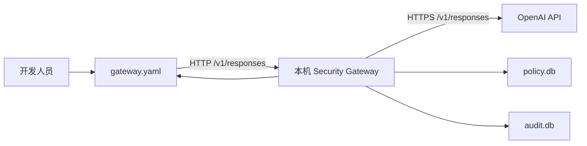
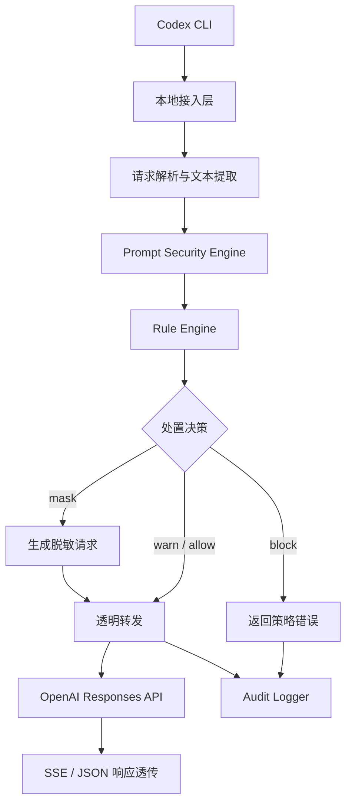

# Codex Security Gateway 轻量化设计文档（MVP）

| 属性 | 内容 |
| --- | --- |
| 文档状态 | 实现中，外部验收未闭合 |
| 版本 | 0.6 |
| 日期 | 2026-08-02 |
| 适用范围 | Codex CLI、Windows/macOS 本地部署、OpenAI GPT 系列模型 |
| 核心目标 | 在模型请求离开开发者电脑前完成检测、处置和审计 |

## 1. 结论与边界

Codex Security Gateway 是运行在开发者本机的单上游安全代理。Codex CLI 的模型请求必须先经过 Gateway；Gateway 对请求中可检查的全部文本内容执行规则检测，再按策略阻断、脱敏或记录告警，最后将允许的请求转发至固定的 OpenAI API 上游。

MVP 解决的是开发者误提交明文敏感信息的风险，不是完整的数据防泄漏系统。仅修改 Codex Endpoint 不能阻止开发者绕过 Gateway，也不能证明企业敏感信息绝不外泄。强制接入需要后续结合终端管控、托管配置和网络出口策略。

### 1.1 已确认事实

- 当前本机验证版本为 Codex CLI `0.144.5`。
- 当前本机模型链路使用 Responses wire API。
- 当前本机未启用 Responses WebSocket，适合先实现 HTTP 请求和 SSE 流式响应代理。
- Codex 支持通过 `config.toml` 和命令行 `-c` 覆盖配置。
- Gateway 无法仅凭模型请求可靠还原某段文本来自哪个文件，因此文件路径级阻断不属于纯网络代理能力。
- 2026-08-01 从 `go.dev/dl` 核对到的最新稳定工具链为 Go `1.26.5`；当前开发机已升级为 Go `1.26.5`。

### 1.2 架构决策

- MVP 只代理 `POST /v1/responses`，不承诺兼容全部 OpenAI API。
- MVP 只支持 HTTP 请求和 SSE 流式响应，不支持 Responses WebSocket。
- Gateway 使用固定 OpenAI 上游，不提供模型切换、路由或 Provider 管理。
- 扫描范围是出站请求中所有已支持的文本字段，不只扫描终端中用户手工输入的一句话。
- 未命中风险规则时默认 `allow`；检测器异常、请求无法解析或内容无法检查时失败关闭并拒绝发送。
- `warn` 在 MVP 中表示“记录告警并继续发送”，不提供交互式二次确认。
- 被拦截请求的决策审计记录全部命中关键字和完整 JSON 请求体；其他审计事件不记录原始 Prompt 或完整请求体，任何事件都不得记录 API Key。
- MVP 使用两个独立 SQLite 数据库：`policy.db` 存储规则配置，`audit.db` 存储审计事件；`gateway.yaml` 只保存启动参数和数据库路径。
- 上游 API Key 和本地访问 Token 不得存入 YAML 或 SQLite，只能从环境变量或操作系统密钥存储读取。
- 后台使用 Go 开发，交付无外部运行时依赖的单一可执行文件。
- 透明代理使用 Go HTTP 客户端直接转发请求和 SSE，不使用 OpenAI SDK 重建请求。
- MVP 原生支持 Windows 和 macOS；首发构建目标收敛为 `windows/amd64` 和 `darwin/arm64`。

## 2. 项目背景

AI Coding 工具会把用户输入、代码上下文、项目指令和工具执行结果组织为模型请求。开发人员在公网环境使用 Codex 时，可能无意中发送以下内容：

- 客户、项目或内部系统名称；
- 源代码中的未公开业务逻辑；
- 数据库连接串、账号、密码和访问令牌；
- 内网 IP、服务地址和生产环境配置；
- Codex 自动读取的配置文件内容；
- 本地工具输出中的敏感数据。

企业需要在模型请求离开开发者电脑前建立一个可配置、可审计的安全检查点，同时尽量不改变 Codex 的常规使用方式。

## 3. 建设目标

### 3.1 业务目标

1. 降低开发人员把企业敏感信息误发至公网模型的概率。
2. 对命中规则的模型请求执行统一处置。
3. 留存可追溯的本地审计证据，被拦截请求包含命中关键字和完整 JSON 请求体。
4. 以最少组件完成 Codex CLI 到 OpenAI API 的单上游代理闭环。

### 3.2 MVP 成功标准

- Codex CLI 能通过 Gateway 正常完成一次非流式和一次 SSE 流式 Responses 请求。
- 命中阻断规则时，上游服务收到的请求数为零。
- 命中脱敏规则时，上游只收到脱敏后的内容。
- 未命中规则时，请求语义、上游状态码和响应流保持不变。
- 每个请求产生可关联的审计事件；被拦截请求可查看阻断时间、命中关键字和完整 JSON 请求体，允许转发的请求必须先成功写入决策事件。
- Gateway 仅监听回环地址，上游地址不能由请求方动态指定。
- Windows AMD64 和 macOS ARM64 原生产物均完成相同功能的 E2E 验证。

### 3.3 非目标

- 多模型选择、降级、负载均衡和成本路由；
- 多 Provider 管理；
- Codex 桌面端、IDE 插件、Claude Code、OpenCode 等客户端适配；
- 企业统一控制台和集中策略下发；
- 语义分类、机器学习 DLP 或源代码相似度检测；
- 模型响应内容审核；
- Prompt 注入、越权工具调用和 Agent 权限治理；
- 文件读取前的路径级拦截；
- 防止恶意开发者主动绕过本地 Gateway；
- ChatGPT 账号登录链路代理，MVP 仅按 API Key 接入设计。
- Windows Service、macOS launchd 后台服务安装和开机自启动。
- Windows ARM64、macOS AMD64 和 Linux 发布包。

## 4. 使用者与关键场景

| 角色 | 职责 |
| --- | --- |
| 开发人员 | 使用 Codex CLI，不维护安全规则 |
| 安全管理员 | 定义关键词、正则、动作和审计保留策略 |
| 本机运维者 | 安装、启动、停止 Gateway，配置密钥和文件权限 |
| 审计人员 | 查看脱敏后的审计事件，定位规则和处理结果 |

### 4.1 核心场景

1. 开发人员输入客户名称，规则命中后请求被阻断。
2. Prompt 或代码上下文命中任意一组“源关键字 → 目标字”映射，全部命中项完成一次性替换后请求继续发送。
3. Codex 把工具输出加入下一次模型请求，Gateway 对工具输出文本执行同等检测。
4. 正常请求通过 Gateway，以 SSE 方式持续返回给 Codex。
5. 规则配置错误时 Gateway 拒绝启动，避免带病放行。
6. 检测器运行异常时请求被阻断并生成系统错误审计事件。

## 5. 威胁模型与信任边界

### 5.1 保护对象

- 企业项目、客户和系统标识；
- 凭证、Token、密码、私钥片段和连接串；
- 内网地址、生产环境信息和未公开接口；
- Codex 请求中的源代码、工具输出和项目指令；
- 上游 OpenAI API Key；
- 规则数据库 `policy.db`；
- 审计数据库 `audit.db` 及其 WAL/SHM 文件。

### 5.2 信任边界



- Codex 到 Gateway：仅允许回环网络访问，但仍要校验本地访问令牌。
- Gateway 到 OpenAI：必须使用 HTTPS 并校验证书。
- `gateway.yaml`、`policy.db`、`audit.db` 及 SQLite WAL/SHM 文件：依赖本机文件权限保护。
- Gateway 进程：持有上游 API Key，日志和错误信息不得泄露该密钥。

### 5.3 MVP 可覆盖的威胁

- 明文敏感关键词；
- 已知格式的密钥、令牌、密码赋值和内网 IPv4 地址；
- 已进入模型请求的配置文件内容和工具输出；
- 对已检测请求的本地行为审计。

### 5.4 残余风险

- 开发人员可修改 Codex 配置并直连上游。
- 本地高权限恶意程序可读取进程环境或篡改规则、日志。
- 编码、拆分、同义改写和未知格式可能绕过关键词或正则规则。
- 规则无法判断所有源代码是否属于企业机密。
- Gateway 能看到已序列化文本，但通常不知道文本来自哪个具体文件。
- 本地 SQLite 审计库不具备集中存证、数据库加密和强防篡改能力。
- macOS Docker Desktop 可通过 `host.docker.internal` 把容器连接代理到宿主机回环端口，宿主应用看到的源地址仍是 `127.0.0.1`。因此仅绑定回环地址不能保证本地容器无法建立 TCP 连接；模型接口仍依赖本地 Token 鉴权，若要求容器网络隔离，必须增加宿主防火墙或容器平台策略。

## 6. 总体架构



### 6.1 组件职责

| 组件 | 职责 | 不负责 |
| --- | --- | --- |
| 本地接入层 | 路由、认证、限流、请求 ID、大小限制 | 模型选择 |
| 请求解析器 | 解压、解析 JSON、提取受支持文本字段 | 推断文件来源 |
| Security Engine | 规范化、关键词和正则检测、合并命中 | 语义分类 |
| Rule Engine | 从 `policy.db` 加载不可变规则快照、验证配置、计算最终动作 | 在线热更新 |
| Masker | 基于原始位置一次性脱敏，避免级联替换 | 自动修复代码语义 |
| Proxy | 固定上游、请求转发、SSE 透传、错误映射 | SDK 级对象重建 |
| Audit Store | 以 SQLite 事务写入阻断详情和其他最小化审计事件、执行保留期清理和权限检查 | 保存请求 Header、凭证或完整上游响应 |

## 7. 请求处理流程

1. 接收 `POST /v1/responses`，生成 `request_id`。
2. 校验来源、路径、本地访问令牌、Content-Type 和请求大小。
3. 按 `Content-Encoding` 解压请求，MVP 支持无压缩和 `gzip`。
4. 解析 JSON；解析失败直接拒绝，不转发上游。
5. 按已验证的字段映射提取全部可检查文本。
6. 对检测副本执行 Unicode 规范化和大小写标准化，原请求暂不修改。
7. 执行关键词和正则规则，记录规则 ID、类型、位置和动作；关键字阻断规则同时保留命中的原始关键字。
8. 按 `block > mask > warn > allow` 计算最终动作。
9. `block`：写入包含阻断时间、全部命中关键字和完整 JSON 请求体的决策审计，再返回 HTTP `403` 和固定提示“内容审计命中风险规则，请调整输入后重试”，上游调用数必须为零。
10. `mask`：按多组“源关键字 → 目标字”映射，从后向前执行一次性、非级联替换，成功写入决策事件后转发新请求。
11. `warn`：成功写入告警决策事件后原样转发，不等待用户确认。
12. `allow`：成功写入允许决策事件后原样转发。
13. 对上游 JSON 或 SSE 响应进行透明传输，不扫描模型响应正文。
14. 请求结束后追加完成事件，记录上游状态、耗时和结果；完成事件不重复记录请求体。

## 8. 功能需求

### 8.1 接入与代理

| 编号 | 需求 |
| --- | --- |
| FR-PXY-001 | Gateway 必须仅监听 `127.0.0.1` 或 `::1`，默认端口为 `8080`。 |
| FR-PXY-002 | Gateway 必须支持 `POST /v1/responses`。 |
| FR-PXY-003 | Gateway 必须支持普通 JSON 响应和 `text/event-stream` 响应。 |
| FR-PXY-004 | Gateway 必须支持无压缩和 `gzip` 请求体。 |
| FR-PXY-005 | Gateway 必须保持上游状态码、SSE 事件顺序和正文，不得缓存完整流式响应后再返回。 |
| FR-PXY-006 | Gateway 必须使用启动配置中的固定 HTTPS 上游，不得接受请求参数或 Header 指定转发目标。 |
| FR-PXY-007 | Gateway 必须删除 hop-by-hop Header，并重新计算被修改请求的 `Content-Length` 和 `Content-Encoding`。 |
| FR-PXY-008 | Gateway 不得转发 Codex 使用的本地访问令牌；必须改用 Gateway 进程环境中的上游 API Key。 |
| FR-PXY-009 | 上游超时、断流和 4xx/5xx 应保留可诊断信息，但不得回显密钥或完整请求。 |
| FR-PXY-010 | 未支持的 API 路径、WebSocket、二进制或无法检查的内容类型必须默认拒绝。 |
| FR-PXY-011 | Gateway 不得自动重试上游模型请求，避免重复执行、重复计费和审计歧义。 |

### 8.2 文本提取与检测

| 编号 | 需求 |
| --- | --- |
| FR-DET-001 | Gateway 必须扫描请求内所有已登记的出站文本字段，而非只扫描首条用户 Prompt。 |
| FR-DET-002 | 字段登记表必须由对目标 Codex 版本抓取的请求样本和契约测试确定。 |
| FR-DET-003 | 未登记字段中出现新的文本或附件结构时必须失败关闭，并记录 `unsupported_payload`。 |
| FR-DET-004 | 关键词检测必须支持中文、英文、大小写配置和 Unicode 规范化；执行脱敏时必须保留规范化文本到原文的区间映射。 |
| FR-DET-005 | 正则检测必须至少覆盖配置的 Token、密码赋值和内网 IPv4 规则。 |
| FR-DET-006 | IP 检测必须校验合法 IPv4 地址和 RFC1918 范围，不能仅用 `\d+\.\d+\.\d+\.\d+`。 |
| FR-DET-007 | 正则执行必须有超时或采用可限制复杂度的正则引擎，避免 ReDoS。 |
| FR-DET-008 | 同一文本可命中多条规则，结果必须保留全部规则 ID 和命中数量。 |
| FR-DET-009 | 规则加载失败、检测异常或扫描超时必须阻断请求。 |
| FR-DET-010 | 图片、音频、文件附件和无法解码的文本在 MVP 中默认阻断。 |

说明：MVP 虽不具备文件路径感知能力，但只要文件内容已进入 Responses 请求中的受支持文本字段，就必须被扫描。这与第二阶段“在文件读取前按路径阻断”是两个不同能力。

### 8.3 规则与处置

| 编号 | 需求 |
| --- | --- |
| FR-RUL-001 | 规则必须与代码分离，并以带 Schema 版本的 `policy.db` 作为运行时唯一权威来源。 |
| FR-RUL-002 | 每条规则必须包含唯一 ID、类型、启用状态、动作，以及该类型要求的匹配配置。 |
| FR-RUL-003 | Gateway 启动时必须完成 SQLite Schema 迁移状态、正则可编译性、规则 ID 唯一性和映射冲突校验。 |
| FR-RUL-004 | MVP 在启动时从 `policy.db` 加载不可变规则快照，规则修改后重启生效，不实现热更新。 |
| FR-RUL-005 | 动作优先级固定为 `block > mask > warn > allow`。 |
| FR-RUL-006 | `block` 必须保证请求未连接上游。 |
| FR-RUL-007 | `mask` 必须只修改命中区间，多个区间重叠时使用确定性合并规则。 |
| FR-RUL-008 | `warn` 必须记录告警并继续请求，不得伪装成交互确认。 |
| FR-RUL-009 | 未命中规则时必须使用全局默认动作，MVP 的全局默认动作固定为 `allow`；安全检测或审计异常仍固定失败关闭。 |
| FR-RUL-010 | 关键字替换规则必须支持配置多组“源关键字 `source` → 目标字 `target`”映射。 |
| FR-RUL-011 | 同一源关键字只能配置一个目标字；源关键字和目标字均不得为空，冲突配置必须导致启动失败。 |
| FR-RUL-012 | 多组替换必须基于原始请求一次性执行，替换产生的目标字不得再次触发其他替换规则。 |
| FR-RUL-013 | 关键字拦截规则必须支持配置多个关键字，任意一个关键字命中即产生 `block` 动作。 |
| FR-RUL-014 | 同一请求命中多个拦截关键字时，必须记录全部去重后的命中关键字。 |

规则通过本地 CLI 写入 `policy.db`，示例：

```bash
codex-gateway policy add-block \
  --id keyword.block-enterprise \
  --keyword 客户A \
  --keyword 项目B

codex-gateway policy add-replacement \
  --id keyword.replace-enterprise \
  --mapping 内部系统A=业务系统 \
  --mapping 生产数据库A=测试数据库

codex-gateway policy add-private-ipv4 \
  --id network.private-ipv4 \
  --action warn
```

`policy` 命令还必须提供 `list`、`enable`、`disable` 和 `delete`。每次写操作使用单个 SQLite 事务；事务提交后递增规则集版本。MVP 运行进程不热加载，修改规则后必须重启 Gateway。

### 8.4 阻断响应

阻断时返回 HTTP `403`，提示内容固定为“内容审计命中风险规则，请调整输入后重试”。响应体保持可被 OpenAI 客户端识别的错误结构：

```json
{
  "error": {
    "message": "内容审计命中风险规则，请调整输入后重试",
    "type": "security_policy_violation",
    "param": null,
    "code": "prompt_blocked"
  }
}
```

响应正文不得返回规则 ID、命中关键字、原始 Prompt 或请求体。响应 Header 应包含 `x-gateway-request-id`，便于与审计事件关联。

错误判定顺序固定为：本地认证、路径和方法、压缩体与大小、Content-Type、JSON 结构、载荷支持范围、安全检测、审计预写、上游调用。前序错误成立后不再执行后序步骤。

| HTTP 状态 | 错误码 | 含义 |
| --- | --- | --- |
| 401 | `gateway_unauthorized` | 本地访问令牌无效 |
| 404 / 405 | `gateway_route_not_supported` | 路径或方法不受支持 |
| 413 | `payload_too_large` | 解压前或解压后请求体超过限制 |
| 415 | `unsupported_media_type` | Content-Type 或 Content-Encoding 不受支持 |
| 422 | `unsupported_payload` | JSON 可解析，但包含未登记字段结构或附件 |
| 403 | `prompt_blocked` | 命中阻断策略，固定提示“内容审计命中风险规则，请调整输入后重试” |
| 503 | `security_engine_unavailable` | 检测超时或内部失败，已失败关闭 |
| 503 | `audit_unavailable` | 转发前决策事件无法写入，已失败关闭 |
| 502 / 504 | `upstream_error` | 上游连接、协议或超时错误 |

### 8.5 审计

| 编号 | 需求 |
| --- | --- |
| FR-AUD-001 | 每个请求必须生成一个唯一 `request_id`；阻断请求写一条决策事件，转发请求至少写一条转发前决策事件和一条转发后完成事件。 |
| FR-AUD-002 | 审计必须记录 UTC 时间、OS 用户标识、规则版本、规则 ID、命中类型、命中数量、动作和处理结果。 |
| FR-AUD-003 | 被拦截请求的决策事件必须记录全部去重后的原始命中关键字，以及解压、解析后的完整 JSON 请求体。 |
| FR-AUD-004 | 放行、替换、告警和完成事件不得记录原始 Prompt 或完整请求体；可使用独立密钥计算 HMAC-SHA256 请求指纹进行同源关联。 |
| FR-AUD-005 | `audit.db`、`audit.db-wal` 和 `audit.db-shm` 的访问权限必须限制为当前用户，启动时发现权限过宽必须拒绝启动。 |
| FR-AUD-006 | 审计事件与其规则、关键字明细必须在同一个 SQLite 事务中写入，禁止出现只有主事件或只有明细的部分数据。 |
| FR-AUD-007 | 转发前决策事务提交失败时必须阻断当前请求；转发后完成事件提交失败时必须把健康状态置为不可用并阻断后续新请求。 |
| FR-AUD-008 | 必须支持按保留天数和数据库大小执行审计清理；清理操作不得删除 `policy.db` 数据。 |
| FR-AUD-009 | 任何审计事件都不得记录 Authorization Header、本地访问令牌、上游 API Key 或完整上游响应。 |
| FR-AUD-010 | 请求体必须作为结构化 JSON 字段写入，不得通过字符串拼接生成日志；字段值保持收到时的内容。 |
| FR-AUD-011 | 命中关键字按首次出现顺序去重记录；同一关键字重复出现时通过 `match_count` 记录总次数。 |

`user` 字段只表示运行 Gateway 的本地 OS 账号，不得作为已认证的企业人员身份使用。企业身份和设备身份属于后续集中治理范围。

被拦截请求的审计日志包含敏感关键字和完整请求体，因此 `audit.db`、WAL、SHM 和备份副本均属于企业敏感资产。MVP 依赖本机文件权限、数据库大小上限和保留期限进行保护；普通 SQLite 不提供静态加密，若要求抵御本机高权限用户读取，还必须增加独立密钥管理和数据库加密，这不属于当前轻量化范围。

建议审计事件：

```json
{
  "schema_version": 1,
  "event_type": "decision",
  "request_id": "req_01...",
  "occurred_at": "2026-08-01T02:20:00Z",
  "user": "developer",
  "rule_set_version": "2026-08-01.1",
  "rule_ids": ["keyword.block-enterprise"],
  "categories": ["keyword"],
  "matched_keywords": ["客户A", "项目B"],
  "match_count": 2,
  "action": "block",
  "result": "blocked",
  "request_body": {
    "model": "gpt-example",
    "input": "请分析客户A的项目B代码"
  },
  "upstream_status": null,
  "duration_ms": 8
}
```

### 8.6 本地存储设计

本地数据严格分为三个边界：

| 载体 | 内容 | 禁止内容 |
| --- | --- | --- |
| `gateway.yaml` | 监听地址、固定上游地址、数据库路径、请求大小、审计保留参数 | API Key、本地访问 Token、请求体 |
| `policy.db` | 拦截关键字、替换映射、正则、动作、启用状态、规则集版本 | 审计事件、凭证 |
| `audit.db` | 决策事件、完成事件、命中规则、命中关键字、被拦截请求体 | 凭证、完整上游响应 |

建议 `gateway.yaml`：

```yaml
version: 1
listen: 127.0.0.1:8080
upstream: https://api.openai.com/v1
policy_db: data/policy.db
audit_db: data/audit.db
max_body_bytes: 5242880
audit_retention_days: 30
audit_max_bytes: 104857600
```

相对路径必须以 `gateway.yaml` 所在目录为基准解析，不能依赖进程当前工作目录。环境变量名固定为 `CODEX_GATEWAY_TOKEN` 和 `OPENAI_API_KEY`，变量值不得回写配置文件或数据库。

`policy.db` 最低表结构：

| 表 | 关键字段 | 用途 |
| --- | --- | --- |
| `schema_migrations` | `version`、`applied_at` | 数据库 Schema 版本 |
| `policy_meta` | `key`、`value` | `rule_set_version` 等元数据 |
| `policy_rules` | `id`、`type`、`action`、`enabled`、`case_sensitive`、`pattern`、`replacement` | 规则主表 |
| `policy_keywords` | `rule_id`、`keyword`、`sort_order` | 一条拦截规则的多个关键字 |
| `policy_mappings` | `rule_id`、`source`、`source_key`、`target`、`sort_order` | 多组一次性替换映射 |

`policy_mappings.source_key` 保存规范化后的源关键字并建立唯一约束，保证同一源关键字只能对应一个目标字。规则主表与子表写入、删除和规则集版本递增必须处于同一个事务。

`audit.db` 最低表结构：

| 表 | 关键字段 | 用途 |
| --- | --- | --- |
| `schema_migrations` | `version`、`applied_at` | 数据库 Schema 版本 |
| `audit_events` | `id`、`request_id`、`event_type`、`occurred_at`、`user_name`、`rule_set_version`、`action`、`result`、`match_count`、`request_body_json`、`upstream_status`、`duration_ms` | 决策和完成事件 |
| `audit_matches` | `event_id`、`ordinal`、`rule_id`、`category`、`matched_keyword` | 事件命中的规则和关键字明细 |

至少建立以下索引：

- `audit_events(occurred_at)`；
- `audit_events(request_id)`；
- `audit_events(action, result)`；
- `audit_matches(matched_keyword)`；
- `audit_matches(rule_id)`。

两个数据库连接初始化时必须执行并验证：

```sql
PRAGMA foreign_keys = ON;
PRAGMA journal_mode = WAL;
PRAGMA synchronous = FULL;
PRAGMA busy_timeout = 5000;
```

数据库迁移必须版本化、幂等并在事务中执行。Gateway 不得在发现高于自身支持版本的数据库时降级或继续启动。审计保留清理必须先按时间删除事件，由外键级联删除明细，再执行 WAL checkpoint；空间回收不得阻塞正在处理的模型请求。

### 8.7 运行与配置

| 编号 | 需求 |
| --- | --- |
| FR-OPS-001 | 提供 `codex-gateway start` 启动命令。 |
| FR-OPS-002 | 提供 `codex-gateway check-config`，只校验配置和规则，不启动代理。 |
| FR-OPS-003 | 提供 `codex-gateway init`，创建 `policy.db`、`audit.db` 和初始 Schema；已存在数据库时不得覆盖。 |
| FR-OPS-004 | 提供 `GET /healthz`，只返回进程、规则版本和数据库状态，不返回密钥、规则内容或请求体。 |
| FR-OPS-005 | 上游 API Key 只能从环境变量或操作系统密钥存储读取，不得写入 YAML、SQLite 或日志。 |
| FR-OPS-006 | 启动信息必须显示监听地址、上游域名、规则版本和数据库路径，但不得显示凭证。 |
| FR-OPS-007 | 收到终止信号时必须停止接收新请求，并完成在途审计事务提交。 |
| FR-OPS-008 | Gateway 必须使用 Go 开发，并构建为不依赖 Python、Node.js 或其他外部语言运行时的单一可执行文件。 |
| FR-OPS-009 | 必须发布 `windows/amd64` 和 `darwin/arm64` 两个独立构建产物。 |
| FR-OPS-010 | Windows 和 macOS 必须使用相同的规则 Schema、审计 Schema、错误码和 HTTP 行为。 |
| FR-OPS-011 | 路径拼接、配置定位、数据库文件和临时文件处理必须使用 Go 跨平台 API，不得硬编码 Unix 路径分隔符。 |
| FR-OPS-012 | macOS 必须使用文件模式限制 YAML、数据库、WAL 和 SHM 文件；Windows 必须使用当前用户 ACL 提供等价访问控制。 |
| FR-OPS-013 | Windows 和 macOS 均必须支持通过终端中断信号执行优雅停止并完成在途审计事务提交。 |

## 9. 非功能需求

### 9.1 安全性

- 所有安全检测和审计前置失败均采用失败关闭；MVP 不提供失败开放模式。
- 上游 TLS 证书校验不得关闭。
- 上游 Host 必须来自启动配置，不得形成开放代理或 SSRF 通道。
- 本地访问令牌和上游 API Key 必须分离。
- 错误堆栈默认只写本机诊断日志，面向 Codex 的响应使用稳定错误码。
- `gateway.yaml` 和数据库目录不得位于所有本机用户均可写的路径。

### 9.2 性能建议基线

以下数值是 MVP 建议验收基线，需由产品负责人结合开发机规格最终确认：

- 最大解压后请求体：`5 MiB`；超限返回 `413`。
- 对不超过 `1 MiB` 的请求，纯检测新增耗时 P95 不高于 `100 ms`。
- SSE 首字节额外代理延迟 P95 不高于 `150 ms`，不包含安全扫描和上游网络耗时。
- 单实例至少支持 `10` 个并发请求，超限返回 `429`，不得无界排队。

### 9.3 可靠性

- 同一请求只能生成一个最终处置结果。
- 每次请求使用不可变规则快照，不能在处理中切换规则版本。
- 上游连接失败不得自动改连其他 Provider 或模型。
- 审计保留清理、WAL checkpoint 和空间回收不能丢失已提交事件。
- 进程启动时必须执行数据库完整性、迁移版本和必需索引检查，检查失败时拒绝启动。

### 9.4 可维护性

- 规则 Schema、审计 Schema 和错误码必须版本化。
- 检测器、处置器、代理和审计模块应相互隔离，便于单元测试。
- 初始规则集必须附带正例、反例和边界样本。
- 版本升级前必须重放 Codex 请求契约样本，识别新增字段和协议变化。

## 10. Codex 接入设计

建议使用独立的本地访问令牌，并由 Gateway 替换为上游 API Key。目标配置草案如下：

```toml
model_provider = "security_gateway"

[model_providers.security_gateway]
name = "Codex Security Gateway"
base_url = "http://127.0.0.1:8080/v1"
env_key = "CODEX_GATEWAY_TOKEN"
wire_api = "responses"
```

运行环境：

macOS：

```bash
export CODEX_GATEWAY_TOKEN='<本机随机访问令牌>'
export OPENAI_API_KEY='<OpenAI API Key>'
./codex-gateway start
```

Windows PowerShell：

```powershell
$env:CODEX_GATEWAY_TOKEN = '<本机随机访问令牌>'
$env:OPENAI_API_KEY = '<OpenAI API Key>'
.\codex-gateway.exe start
```

约束：

- `CODEX_GATEWAY_TOKEN` 只用于 Codex 到本机 Gateway 的认证，不得转发上游。
- `OPENAI_API_KEY` 只由 Gateway 进程读取并写入上游 Authorization Header。
- Gateway 不修改请求中的模型名称，也不根据模型名称选择不同上游。
- 上述配置必须在目标 Codex 版本上通过严格配置校验和真实请求契约测试后，才能作为发布配置。

## 11. 技术方案建议

| 模块 | 技术选型 | 原因 |
| --- | --- | --- |
| 开发语言 | Go | 可交叉编译为 Windows 和 macOS 单一可执行文件 |
| Web 服务 | Go 标准库 `net/http` | 跨平台、依赖少，满足本地 HTTP 服务需求 |
| 上游代理 | `net/http.Client` + 流式 Body 转发 | 保留原始 HTTP/SSE 语义，避免 SDK 重建请求丢字段 |
| 启动配置 | `gopkg.in/yaml.v3` + Go 结构体校验 | 只解析 `gateway.yaml` 启动参数和数据库路径 |
| SQLite | `database/sql` + `modernc.org/sqlite` | 纯 Go 驱动，不引入 CGO，支持 Windows AMD64 和 macOS ARM64 |
| 关键词匹配 | 小规则集先用确定性扫描；规模增长后使用 Aho-Corasick | 避免为 MVP 提前引入复杂依赖 |
| 正则 | Go 标准库 `regexp` | 使用 RE2 语义，不支持灾难性回溯 |
| 审计 | SQLite 事务 + JSON 请求体字段 | 支持按时间、关键字、规则和结果查询，并保证事件与明细原子写入 |
| 测试 | Go `testing`、`httptest`、假 SSE 上游 | 验证未泄露、透明转发和断流行为 |
| 构建 | Go 交叉编译，优先 `CGO_ENABLED=0` | 降低 Windows、macOS 发布包的本机依赖差异 |

Go 版本固定如下：

```text
go 1.26.0
toolchain go1.26.5
```

- `go.mod` 的最低语言版本使用 `1.26.0`。
- 开发环境、CI 和正式发布统一使用 `go1.26.5`。
- 后续只在完成依赖、单元、契约和双平台 E2E 回归后升级 Go 次版本或主版本；安全补丁版本应优先升级。

透明代理层不使用 OpenAI SDK。SDK 会把请求解析为当前版本对象再重新序列化，可能遗漏 Codex 新增字段，也不利于保持上游 Header、状态码和 SSE 事件语义。

## 12. 建议项目结构

```text
codex-security-gateway/
├── cmd/
│   └── codex-gateway/
│       └── main.go
├── internal/
│   ├── app/
│   │   └── app.go
│   ├── gateway/
│   │   ├── handler.go
│   │   └── proxy.go
│   ├── security/
│   │   ├── extractor.go
│   │   ├── detector.go
│   │   ├── masker.go
│   │   └── models.go
│   ├── audit/
│   │   ├── store.go
│   │   └── models.go
│   ├── config/
│   │   ├── loader.go
│   │   └── models.go
│   └── storage/
│       ├── migrations.go
│       ├── policy.go
│       └── audit.go
├── config/
│   └── gateway.yaml
├── tests/
│   ├── contract/
│   └── e2e/
├── go.mod
├── go.sum
└── README.md
```

## 13. 验收标准

| 编号 | 验收条件 |
| --- | --- |
| AC-001 | Codex CLI 通过 Gateway 完成一次普通 Responses 请求，响应内容与假上游一致。 |
| AC-002 | Codex CLI 通过 Gateway 完成一次 SSE 请求，事件顺序、结束事件和错误事件不丢失。 |
| AC-003 | Prompt 命中任意一个拦截关键字后返回 HTTP `403`、错误码 `prompt_blocked` 和固定提示“内容审计命中风险规则，请调整输入后重试”，假上游调用数为零。 |
| AC-004 | 请求的代码上下文或工具输出命中阻断规则时，同样不调用上游。 |
| AC-005 | 同一请求命中多组替换映射时，假上游收到全部目标字；替换非级联，未命中区间保持不变。 |
| AC-006 | 多条规则同时命中时，最终动作符合固定优先级，审计包含全部规则 ID。 |
| AC-007 | 非法 JSON、超限请求、未知文本字段、附件和不支持的 Content-Type 均不调用上游。 |
| AC-008 | `gzip` 请求可检测；脱敏后重新编码的请求可被假上游正确解析。 |
| AC-009 | 正则超时、审计写入失败和规则引擎异常均失败关闭。 |
| AC-010 | Gateway 只监听回环地址，外部主机无法连接。 |
| AC-011 | 请求 Header 不能覆盖上游地址，不能把 Gateway 当作开放代理。 |
| AC-012 | 上游 400、401、429、500 和 SSE 中途断流均能返回可诊断结果，且不泄露凭证。 |
| AC-013 | 无效 `gateway.yaml`、不支持的数据库版本、重复规则 ID、非法正则、空映射和同一源关键字对应多个目标字会导致启动失败。 |
| AC-014 | 可从 `audit.db` 查询被拦截请求的 UTC 时间、全部去重命中关键字和完整 JSON 请求体；数据库中不得出现 Authorization Header、本地访问令牌或上游 API Key。 |
| AC-015 | 在确定的基准机和数据集上满足最终确认的请求大小、时延和并发指标。 |
| AC-016 | `windows/amd64` 产物在原生 Windows 环境完成启动、配置校验、关键字替换、关键字拦截、审计和优雅停止 E2E。 |
| AC-017 | `darwin/arm64` 产物在 Apple Silicon macOS 原生环境完成相同 E2E。 |
| AC-018 | 两个目标平台对同一契约样本产生相同处置结果、错误码和审计字段。 |
| AC-019 | `policy.db` 和 `audit.db` 使用独立文件；删除过期审计数据不改变规则数量、规则集版本或处置结果。 |
| AC-020 | 模拟审计事务在写入明细前失败时，事件与明细均不落库且请求不发送上游。 |
| AC-021 | `policy.db` 中规则更新与规则集版本递增具有原子性，进程重启后加载同一完整快照。 |

## 14. 测试分层

| 层级 | 重点 |
| --- | --- |
| 单元测试 | Unicode 规范化、多关键字拦截、多组非级联替换、IPv4、重叠区间、动作优先级、审计字段 |
| 规则测试 | `policy.db` 迁移、事务、CRUD，以及每条规则的正例、反例、边界值和误报样本 |
| 契约测试 | Codex Responses 请求字段、Header、`gzip`、普通 JSON、SSE 事件 |
| 集成测试 | Gateway、两个 SQLite 数据库与假上游之间的阻断、脱敏、审计事务、透传、错误和断流 |
| E2E 测试 | 在 Windows AMD64 和 Apple Silicon macOS 上运行真实 Codex CLI，Gateway 指向受控假上游，不向公网发送测试敏感数据 |

发布证据必须区分：单元测试通过、契约测试通过、交叉编译成功、目标平台原生运行通过、真实 Codex E2E 通过和公网 OpenAI 联调通过。交叉编译成功不能替代 Windows 或 macOS 原生运行证据，前三类测试也不能替代生产网络和真实凭证联调证据。

## 15. 部署与运行

MVP 采用单机单进程部署：

```text
Codex CLI
    |
    | HTTP + local token
    v
127.0.0.1:8080
Codex Security Gateway
    |
    | HTTPS + OpenAI API Key
    v
api.openai.com
```

最低运行要求：

- 进程以普通用户身份运行，不要求管理员权限。
- `gateway.yaml`、`policy.db`、`audit.db`、WAL 和 SHM 文件仅当前用户可读写；macOS 使用文件模式，Windows 使用用户 ACL。
- 上游 API Key 通过进程环境或系统密钥存储注入。
- Gateway 未启动或健康检查失败时，Codex 请求应失败，不能自动直连 OpenAI。
- 更新规则采用“校验配置、停止接入、重启、健康检查”的顺序。

首次运行：

```bash
codex-gateway init --config config/gateway.yaml
codex-gateway policy add-block --config config/gateway.yaml --id keyword.block-enterprise --keyword 客户A
codex-gateway check-config --config config/gateway.yaml
codex-gateway start --config config/gateway.yaml
```

首发发布矩阵：

| 操作系统 | 架构 | 产物 |
| --- | --- | --- |
| Windows | AMD64 | `codex-gateway-windows-amd64.exe` |
| macOS | ARM64 | `codex-gateway-darwin-arm64` |

每个产物必须携带版本信息和构建提交标识。发布包需分别验证文件类型、目标架构、校验和以及原生 E2E，不能只验证压缩包存在。

## 16. 第二阶段：Context Guard

第二阶段目标是在 Codex 读取文件前依据文件路径和项目策略阻断，例如：

```yaml
version: 1
forbidden_files:
  - .env
  - application-prod.yml
  - secret.yaml
  - '*.pem'
  - '*.key'
  - kubeconfig
```

该能力不能只在 HTTP Gateway 内实现，因为 Gateway 通常只能看到文件内容，不能可靠获得原始路径。需要评估 Codex Hook、沙箱策略或受管启动器，在文件读取和工具调用阶段执行策略。Gateway 仍作为最后一道出站内容检查层。

## 17. 后续演进

### Phase 1：Prompt Guard

- Responses HTTP/SSE 代理；
- 出站文本检测；
- block、mask、warn；
- 被拦截请求的关键字和完整请求体审计。

### Phase 2：Context Guard

- 文件读取前路径策略；
- 项目级敏感目录；
- 工具输出来源标识；
- Gateway 与本地 Hook 联动。

### Phase 3：AI Coding Security Platform

- 多客户端接入；
- 集中策略和审计；
- 终端身份与设备注册；
- Tool Guard 和 Agent 权限治理；
- 企业网络出口强制接入；
- 语义 DLP 和代码指纹。

## 18. 实施前待确认事项

### 18.1 外部未闭合项

截至 2026-08-02，以下事项尚未形成可复核的验收证据，状态统一为 `OPEN`：

| 关联项 | 当前未闭合内容 | 闭合条件 |
| --- | --- | --- |
| AC-001 | Codex CLI `0.144.5` 尚无已验证的非流式 Responses 配置，不能据此声明真实 Codex 非流式链路通过。 | 确认该版本可用的非流式配置或冻结一个支持该能力的目标版本；使用真实 Codex CLI 经 Gateway 调用假上游，并归档配置、请求、响应和测试结果。 |
| AC-010 | 仅有回环监听配置或本机检查，缺少另一台主机连接失败的外部证据。 | 从另一台主机连接 Gateway 所在设备的非回环地址和端口，确认连接失败，并归档 Gateway 监听地址、测试网络环境、执行命令和结果。 |
| AC-015 | 性能指标仍为建议值，正式基准机、数据集和规则规模尚未冻结。 | 冻结基准机硬件、操作系统、网络条件、请求样本、规则数量、并发模型和指标阈值，完成可重复的基准测试并形成报告。 |
| AC-016、AC-018 | 已有交叉构建不能代替 Windows 原生运行；缺少 `windows/amd64` 原生 E2E 以及与 `darwin/arm64` 的同样本结果对比。 | 在原生 Windows AMD64 环境完成 AC-016 全部场景，并使用同一规则库和契约样本与 macOS ARM64 对比处置结果、错误码和审计字段。 |
| 公网 OpenAI 联调 | 缺少可用的公网 OpenAI 测试账号、脱敏测试数据和联调审批。 | 明确账号责任人和凭证注入方式，完成数据脱敏及安全审批，在批准的环境执行联调并保存不含凭证的结果。 |
| 第 18 节确认事项 | 产品负责人和安全负责人尚未完成本节决策项确认。 | 每一项形成明确结论、责任人和确认记录；存在范围变更时同步更新需求、验收标准和测试计划。 |

上述事项不阻止本地代码开发、单元测试、契约测试和假上游集成测试，但在全部闭合前，不得将 AC-001、AC-010、AC-015、AC-016、AC-018 标记为通过，也不得声明 MVP 已完成发布验收或具备正式发布条件。

### 18.2 产品与安全负责人待确认事项

以下问题会改变实现或验收，必须由产品负责人和安全负责人确认；未确认项不得作为已冻结需求进入对应范围的开发或验收：

1. MVP 是“开发者自愿接入”还是“企业强制接入”；后者需要增加终端和网络控制范围。
2. Windows ARM64、macOS AMD64 或 Linux 是否进入后续发布范围；当前首发矩阵均不包含。
3. 是否接受“Gateway 持有上游 API Key、Codex 只持有本地 Token”的认证方案。
4. 初始敏感关键词、Token 格式、密码格式和内网范围由谁维护，是否有可用于测试的脱敏样本集。
5. 哪些规则允许 `mask` 或 `warn`；凭证类规则建议只允许 `block`。
6. 包含完整拦截请求体的审计日志保留期限、最大磁盘占用、查看权限和导出责任人。
7. 是否确认 `5 MiB`、检测 P95 `100 ms`、SSE 代理 P95 `150 ms`、并发 `10` 的建议基线。
8. 目标 Codex 版本和升级策略；每次升级是否必须重新执行请求契约测试。
9. 是否明确禁止图片和文件附件；若必须支持，需要增加对应内容提取与扫描方案。
10. 公网 OpenAI 联调使用的测试账号、脱敏数据和发布审批流程。
11. Go 依赖升级审批人和安全漏洞修复时限；Go 工具链版本已固定为 `go1.26.5`。

以上事项的未确认状态不阻止已冻结范围内的本地实现和测试；但在确认记录、目标 Codex 请求样本和初始规则集全部交付前，不得扩大实现范围，也不得标记为“发布验收通过”或“可正式发布”。
